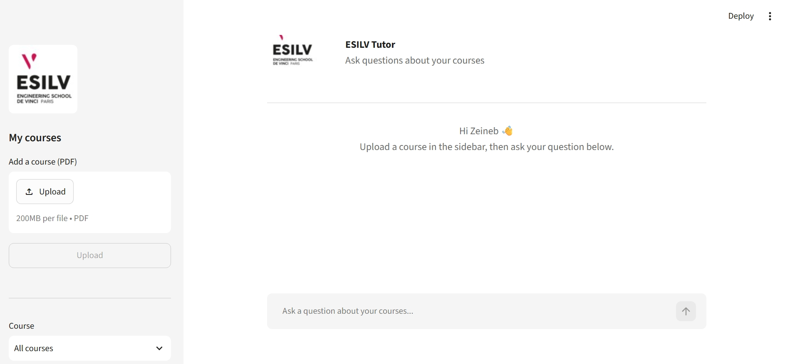
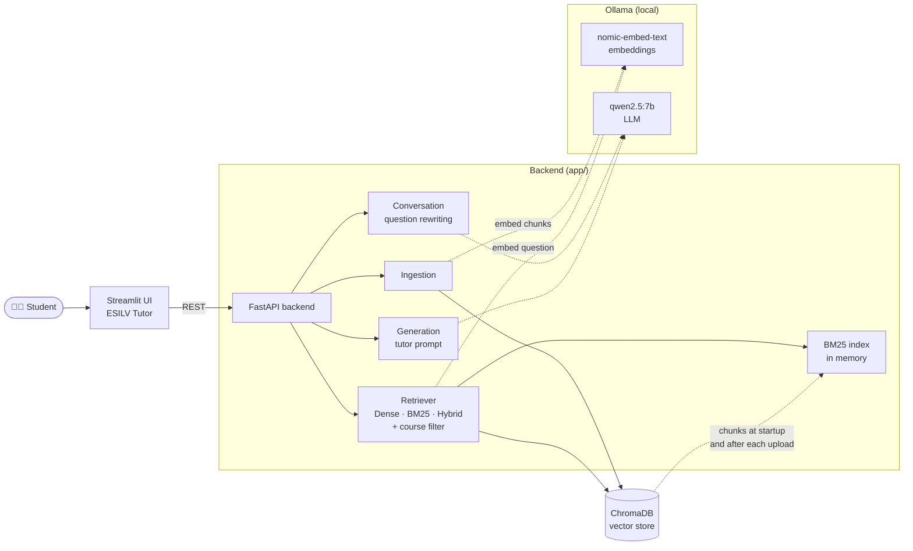
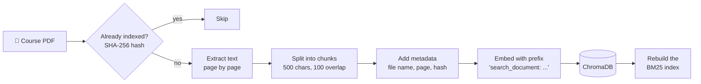
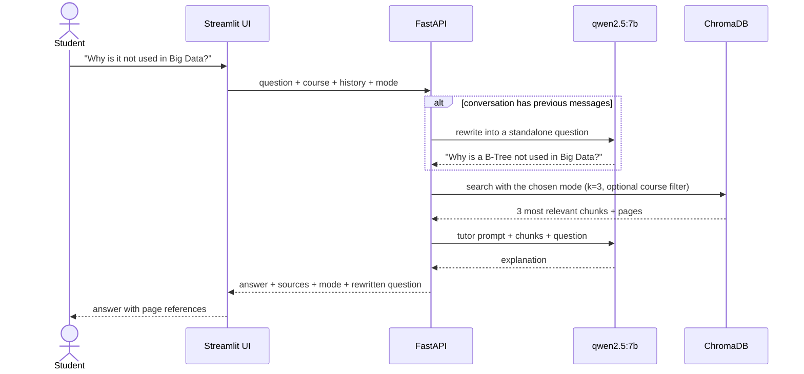
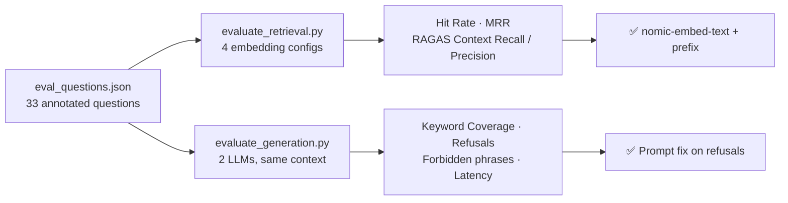

<div align="center">


# ESILV Tutor

**A local RAG study assistant that explains my engineering courses — and shows the exact slide every answer comes from.**


</div>

---

## Table of Contents

1. [Why I built it](#why-i-built-it)
2. [Features](#features)
3. [Demo](#demo)
4. [How it works](#how-it-works)
5. [Evaluation-driven design](#evaluation-driven-design)
6. [Tech stack](#tech-stack)
7. [Project structure](#project-structure)
8. [Getting started](#getting-started)
9. [Configuration](#configuration)
10. [API reference](#api-reference)
11. [Limitations & roadmap](#limitations--roadmap)
12. [Author](#author)

---

## Why I built it

As an engineering student at **ESILV**, most of my courses come as lecture slides: short sentences, keywords, diagrams. Reviewing them is hard — the slides say *what*, but rarely *why*.

I wanted a tutor that:

- **explains** a concept simply, like a teacher would,
- answers **only from my own course material**, not from the internet,
- **cites the slide and page** so I can always check the source,
- says **"I don't know"** when the answer is not in my courses,
- runs **100% locally**, so my course files never leave my computer.

ESILV Tutor is that tool: a Retrieval-Augmented Generation (RAG) application built around my courses.

---

## Features

| | Feature | Description |
|---|---|---|
| 💬 | **Chat with your courses** | Ask questions in natural language and get a clear, structured explanation. |
| 📄 | **Page-level sources** | Every answer lists the PDF and page numbers it is based on. |
| 📚 | **Course filter** | Search all courses at once, or only inside one course. |
| 🔍 | **3 retrieval modes** | Switch live between **Dense** (embeddings), **BM25** (keywords) and **Hybrid** (both, merged with Reciprocal Rank Fusion). |
| 🔁 | **Follow-up questions** | *"Can you explain it more simply?"* works: follow-ups are rewritten using the conversation history. |
| 🚫 | **Honest refusals** | Out-of-scope questions get *"I could not find this information in your course materials."* |
| ♻️ | **Duplicate detection** | Re-uploading the same PDF is detected with a SHA-256 hash. |
| 🔒 | **Fully local** | LLM and embeddings run with Ollama — no API key, no data sent outside. |
| 📊 | **Built-in evaluation** | Scripts to compare embedding models, retrieval modes and LLMs with RAGAS and custom metrics. |

---

## Demo

<div align="center">

</div>

Example of a conversation (illustrative, answers shortened):

> **Me:** What is a B-Tree?
> **Tutor:** A B-Tree is a data structure used by standard databases to look up a row by its ID in log(N)... *(Sources: p. 29, 31)*
>
> **Me:** Why is it not used in Big Data?
> *🔎 Understood as: Why is a B-Tree not used in Big Data?*
> **Tutor:** B-Trees are only efficient when they are mostly cached in memory. In Big Data, keeping petabytes in RAM is not realistic, so systems prefer compressed, columnar Parquet files... *(Source: p. 30)*

---

## How it works

### Architecture



### 1. Indexing a course



My own setup indexes **9 PDFs** (6 lecture decks + 3 TD exercise sheets), which gives **613 chunks**.

### 2. Answering a question



### Retrieval modes

| Mode | How it finds chunks | Good at |
|---|---|---|
| `dense` (default) | `nomic-embed-text` embeddings, similarity search in ChromaDB | Questions worded differently from the slides |
| `bm25` | Keyword search (lowercase words, English stopwords removed) | Rare exact terms: `.crc`, `TimSort`, `DeltaLake` |
| `hybrid` | Top 10 of Dense + top 10 of BM25, merged with **Reciprocal Rank Fusion** (each chunk scores `1 / (60 + rank)` per list, equal weights), then the top `TOP_K` | Both |

The BM25 index is built in memory from the chunks already stored in ChromaDB, when the backend starts and after each new upload. The BM25 and fusion code lives in `app/search.py` and is shared with the evaluation, so the app and the measured results use exactly the same logic.

### The tutor prompt

The LLM is instructed to behave like a patient teacher, with rules designed from real mistakes observed during testing:

- use **only** the course context, and only the parts relevant to the question;
- keep the **exact meaning** of the slides (watch negations like *"all"*, *"not"*);
- never invent the meaning of an unexplained acronym;
- answer with a **short direct answer**, then a **simple explanation**;
- **refuse only** when the context contains nothing relevant.

---

## Evaluation-driven design

Every important choice in this project was **measured**, not guessed. Steps 1 and 2 use a first set of **33 questions** on a Big Data course (NoSQL vs OLTP databases), annotated with the expected pages and keywords. Step 3 uses a larger set of 124 questions on all the courses.

| Type | Count | Example |
|---|---:|---|
| Factual | 8 | *What does ACID stand for?* |
| Conceptual | 9 | *Why is the commit with `_temporary` directories not really atomic?* |
| Paraphrased | 14 | *Why can't Hadoop update a single record in place inside a file?* |
| Out of scope | 2 | *What is MongoDB and how does it store documents?* |



### Step 1 — Choosing the embedding model (retrieval)

Four configurations were compared. Each one indexes the course in a temporary in-memory collection, so the app database is never touched.

**Paraphrased questions** (the realistic ones — written like a student, without the slide wording):

| Embedding model | Hit Rate@3 | MRR | Context Recall (RAGAS) | Index time |
|---|---:|---:|---:|---:|
| mxbai-embed-large + prefix | 93% | **0.89** | **86%** | 14.3 s |
| all-minilm | 93% | **0.89** | 79% | **2.0 s** |
| **nomic-embed-text + prefix** ✅ | 93% | 0.86 | 82% | 6.0 s |
| nomic-embed-text (no prefix) | 86% | 0.77 | 79% | 6.0 s |

**Findings**

- 🔑 **The prefix matters.** `nomic-embed-text` was trained with `search_query:` / `search_document:` prefixes. Adding them raised the MRR from **0.77 to 0.86** — same model, same speed, zero cost.
- `mxbai-embed-large` is slightly better, but the gap is a single question while indexing is 2.4× slower. **Choice: `nomic-embed-text` + prefix.**
- ⚠️ **Ceiling effect:** on questions reusing the slide wording, all models scored ~97%. Only paraphrased questions could separate them.
- Context Precision stays around 36–39% for every model: with k=3 and usually one relevant page, the maximum possible is ~33–50%. It depends on `TOP_K`, not on the model.

### Step 2 — Choosing the LLM (generation)

Both LLMs receive **exactly the same retrieved context** for each question; only the model changes.

| LLM | Keyword Coverage ↑ | False Refusal ↓ | Correct Refusal ↑ | Forbidden Phrases ↓ | Latency ↓ |
|---|---:|---:|---:|---:|---:|
| llama3.2:3b | 64% | **3%** | 100% | 0 | **18.4 s** |
| qwen2.5:7b | 62% | 39% | 100% | 0 | 31.4 s |

| Metric | Meaning |
|---|---|
| Keyword Coverage | Share of expected keywords found in the answer |
| False Refusal | In-scope questions wrongly answered with *"I could not find this information"* |
| Correct Refusal | Out-of-scope questions correctly refused |
| Forbidden Phrases | Known wrong statements (e.g. reversing *"all old files deleted"*) |

**Findings**

- 🔍 The evaluation revealed that `qwen2.5:7b` was **too cautious**: it refused **39%** of in-scope questions — often while quoting the right answer in the same reply.
- The cause was the prompt: strict *"do not guess"* rules added to fix earlier hallucinations made the model over-refuse.
- ✅ **Fix:** the refusal sentence is now reserved for contexts with *nothing* relevant; partial information must be used. *(Re-evaluation with the new prompt is the next step.)*
- `llama3.2:3b` answers more often and faster, but manual review showed it sometimes states facts not present in the slides — something keyword metrics cannot detect.

### Step 3 — Dense vs BM25 vs Hybrid (retrieval)

All **9 PDFs** are indexed together (613 chunks), like in the app with no course filter. The **124 questions** are annotated with every page that answers them, in any PDF ([details](evaluation/datasets/README.md)):

| Type | Count | Example |
|---|---:|---|
| Factual | 29 | *What is a task in Spark?* |
| Conceptual | 31 | *What is the main difference between Yarn and Kubernetes?* |
| Paraphrased | 34 | *How can a company share cluster capacity between several teams?* |
| Lexical | 30 | *What is a .crc file used for?* |

12 of them come from the teacher's TD exercises. 10 extra out-of-scope questions are kept for the generation tests.

**Results (k=3, all 124 questions):**

| Mode | Hit Rate@3 | MRR |
|---|---:|---:|
| Dense | 76% | 0.65 |
| BM25 (stopwords removed) | 73% | 0.60 |
| **Hybrid (RRF)** | **77%** | **0.70** |

**Findings**

- Dense and BM25 are **complementary**: at least one of them finds a relevant page for 86% of the questions, but they miss different ones.
- Hybrid gives the **best ranking** (MRR 0.65 → 0.70) and helps most on paraphrased and lexical questions. Its Hit Rate gain is small: it wins 9 questions and loses 7 compared with Dense.
- Removing English stopwords matters for BM25 on slides: Hit Rate went from 61% to 73%.
- Dense stays the default mode. Hybrid is available in the app to compare live, and the fusion settings (weights, number of candidates) are still to be tuned.

Full results, with the questions each mode misses: [k=3](evaluation/results/retrieval_dense_vs_bm25_k3.md) · [k=5](evaluation/results/retrieval_dense_vs_bm25_k5.md).

### What I learned

1. **Evaluate each RAG stage separately.** A wrong answer can come from retrieval (wrong pages) *or* generation (right pages, wrong reading). Measuring both tells you what to fix.
2. **Easy test sets lie.** Questions copied from the slides made every model look perfect.
3. **Prompting is a trade-off.** Making a model less creative can make it too cautious. Measuring *both* false refusals and correct refusals finds the balance.
4. **Metrics are not enough.** Keyword metrics miss unfaithful sentences; reading the side-by-side answers remains essential.

---

## Tech stack

| Layer | Technology |
|---|---|
| Interface | Streamlit (chat UI, ESILV theme) |
| Backend | FastAPI, Pydantic |
| RAG framework | LangChain |
| Vector store | ChromaDB (persistent) |
| Embeddings | `nomic-embed-text` via Ollama |
| Keyword search | BM25 (`rank_bm25`), Reciprocal Rank Fusion for Hybrid |
| LLM | `qwen2.5:7b` via Ollama (temperature 0) |
| PDF parsing | PyPDF |
| Evaluation | RAGAS + custom metrics |
| Deployment | Docker Compose (backend, frontend, evaluation) |

---

## Project structure

```text
ESILV_Tutor/
├── app/                        # FastAPI backend — the RAG pipeline
│   ├── main.py                 # API routes: /, /courses, /upload, /ask
│   ├── config.py               # Models, paths, chunking, prefixes
│   ├── schemas.py              # Request models (question, course, history, mode)
│   ├── ingestion.py            # Load, split and index PDFs
│   ├── retriever.py            # Vector store, prefixed embeddings, BM25 and Hybrid search
│   ├── search.py               # BM25 + Reciprocal Rank Fusion (shared with the evaluation)
│   ├── courses.py              # Course list, course filter, retrieval mode
│   ├── conversation.py         # Follow-up question rewriting
│   └── generation.py           # Tutor prompt + LLM
├── ui/
│   ├── ui.py                   # Streamlit chat interface
│   └── assets/esilv_logo.png
├── evaluation/
│   ├── eval_questions.json     # 33 annotated questions (one course)
│   ├── evaluate_retrieval.py   # Embedding model comparison
│   ├── evaluate_generation.py  # LLM comparison
│   ├── compare_k.py            # Generation test, k=3 vs k=5
│   ├── datasets/               # 134 annotated questions on all courses + validate.py
│   ├── retrieval/              # Dense vs BM25 vs Hybrid comparison
│   └── results/                # Tables, CSV and side-by-side answers
├── scripts/
│   └── ingest.py               # Index a PDF from the command line
├── data/                       # Sample PDFs (courses/ is git-ignored)
├── .streamlit/config.toml      # ESILV colour theme
├── Dockerfile                  # Backend image
├── Dockerfile.ui               # Frontend image
├── Dockerfile.eval             # Evaluation image (with RAGAS)
├── compose.yaml
├── requirements.txt
└── requirements-eval.txt
```

---

## Getting started

### Prerequisites

- [Docker Desktop](https://www.docker.com/products/docker-desktop/)
- [Ollama](https://ollama.com/) installed and running on your machine

### 1. Download the models

```bash
ollama pull qwen2.5:7b
ollama pull nomic-embed-text
```

### 2. Configure the environment

```bash
cp .env.example .env            # Windows PowerShell: Copy-Item .env.example .env
```

### 3. Start the application

```bash
docker compose up --build
```

| Service | URL |
|---|---|
| ESILV Tutor (UI) | http://localhost:8501 |
| API documentation | http://localhost:8000/docs |

Then upload a course PDF from the sidebar and start asking questions.

### Run without Docker

```bash
pip install -r requirements.txt
uvicorn app.main:app --reload       # backend
streamlit run ui/ui.py              # frontend (in a second terminal)
```

### Run the evaluation

The evaluation expects the course PDFs in `data/courses/`.

```bash
# Extra models used for the comparisons
ollama pull mxbai-embed-large
ollama pull all-minilm
ollama pull llama3.2:3b

# Retrieval: compare embedding models (~1 min)
docker compose run --rm evaluation

# Retrieval: compare Dense, BM25 and Hybrid on the 124 questions (k = TOP_K from .env)
docker compose run --rm evaluation python -m evaluation.retrieval.run
# Same with k=5
docker compose run --rm -e TOP_K=5 evaluation python -m evaluation.retrieval.run

# Check the datasets against the PDFs, and test the metrics
docker compose run --rm evaluation python evaluation/datasets/validate.py
docker compose run --rm evaluation python -m evaluation.retrieval.test_metrics

# Generation: compare LLMs (~45 min on CPU)
docker compose run --rm evaluation python -m evaluation.evaluate_generation

# Recompute generation metrics from saved answers (no LLM call)
docker compose run --rm evaluation python -m evaluation.evaluate_generation --rescore
```

Results are written to `evaluation/results/`.

---

## Configuration

Environment variables (`.env`):

| Variable | Default | Description |
|---|---|---|
| `OLLAMA_BASE_URL` | `http://localhost:11434` | Ollama server (use `http://host.docker.internal:11434` from Docker) |
| `LLM_MODEL` | `qwen2.5:7b` | Model that writes the answers |
| `EMBEDDING_MODEL` | `nomic-embed-text` | Model that embeds chunks and questions |
| `TOP_K` | `3` | Number of chunks retrieved per question |

Other settings in `app/config.py`: collection name, chunk size (500) and overlap (100), embedding prefixes.

> ⚠️ Changing the embedding model, the prefixes or the chunk size requires re-indexing the courses (change `COLLECTION_NAME` and upload the PDFs again).

---

## API reference

| Method | Endpoint | Description |
|---|---|---|
| `GET` | `/` | Health check |
| `GET` | `/courses` | List of indexed courses |
| `POST` | `/upload` | Index a PDF (`multipart/form-data`, field `file`) |
| `POST` | `/ask` | Ask a question |

Example `/ask` request:

```json
{
  "question": "Why is it not used in Big Data?",
  "course": "1.1-comparison-NoSql-DB-vs-standard-DB.pdf",
  "mode": "hybrid",
  "history": [
    { "role": "user", "content": "What is a B-Tree?" },
    { "role": "assistant", "content": "A B-Tree is a data structure..." }
  ]
}
```

Response:

```json
{
  "question": "Why is it not used in Big Data?",
  "standalone_question": "Why is a B-Tree not used in Big Data?",
  "answer": "B-Trees are only efficient when...",
  "sources": [{ "file": "1.1-comparison-NoSql-DB-vs-standard-DB.pdf", "page": "30" }],
  "mode": "hybrid"
}
```

`course` is optional (all courses are searched when omitted) and `history` can be empty. `mode` is `"dense"` (default), `"bm25"` or `"hybrid"`.

---

## Limitations & roadmap

### Current limitations

- **Image-only slides are invisible.** Text is extracted with PyPDF, so diagrams and screenshots are not understood.
- **CPU speed.** Without a GPU, `qwen2.5:7b` takes about 30–60 s per answer.
- **Faithfulness.** The model sometimes adds general knowledge that is not in the slides; always check the cited pages.
- **Evaluation set size.** 124 retrieval questions written by one person: results are indicative, not definitive (see the known bias in [evaluation/datasets/README.md](evaluation/datasets/README.md)).

### Roadmap

- [ ] Re-run the generation evaluation with the revised prompt
- [ ] Separate *"From your course"* and *"General knowledge"* in answers
- [ ] Tune `TOP_K` (3 vs 5) with the retrieval evaluation
- [ ] Tune the Hybrid fusion (weights, number of candidates) and choose the default mode
- [ ] Faithfulness metric with an LLM judge (RAGAS)
- [ ] Quiz mode: the tutor asks questions about a course
- [ ] OCR for image-only slides
- [ ] Persistent conversation history

---

## Author

**Zeineb Daly** — Engineering student at ESILV (Paris)
